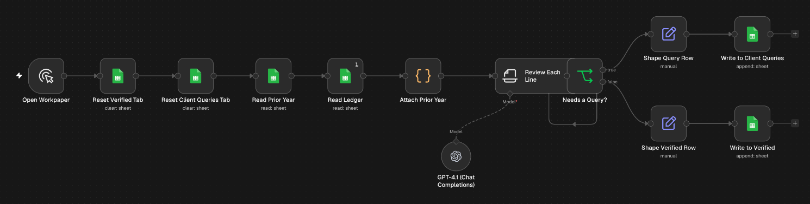
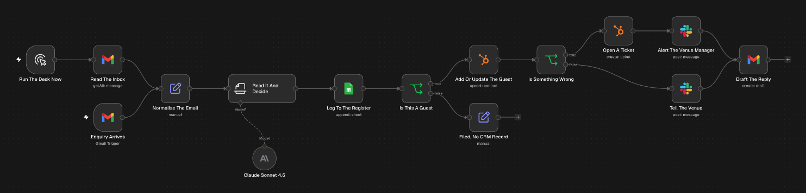
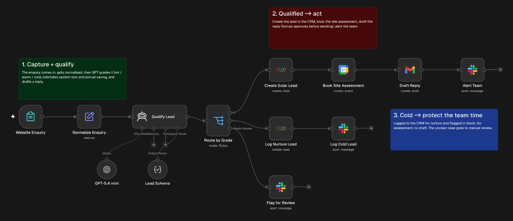
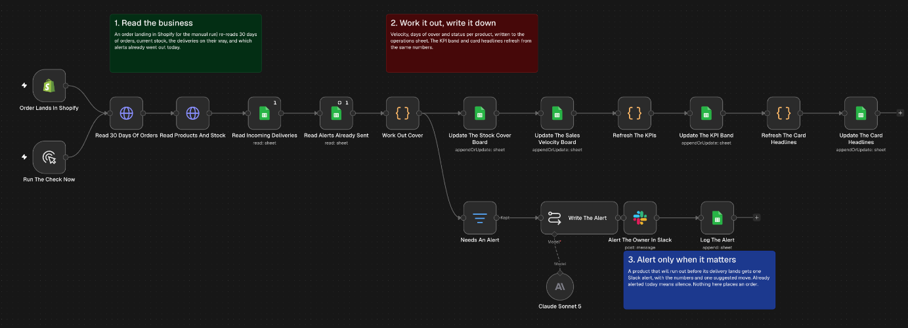
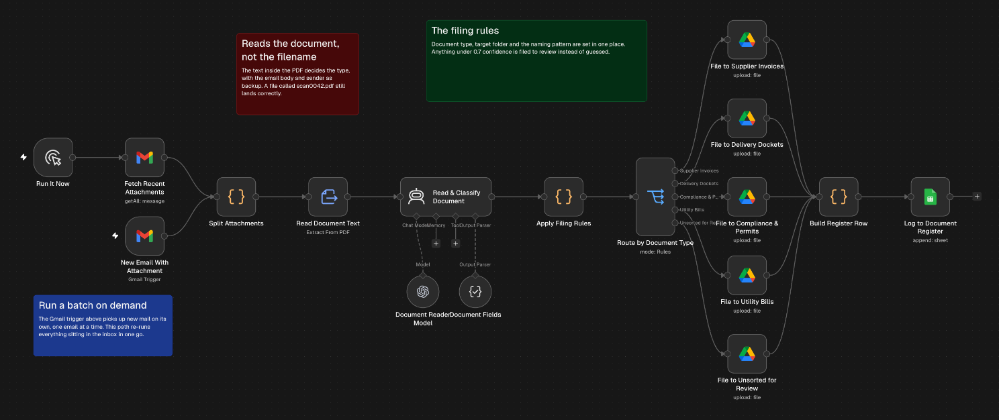
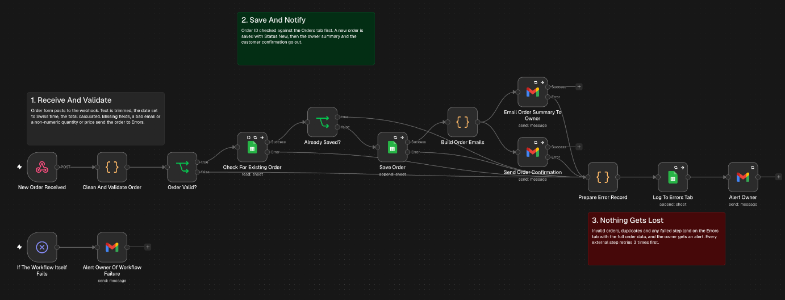

# n8n workflows

Six n8n workflows I've built, exported so you can read them or import them into your own n8n. Each folder has the workflow JSON and a short README explaining how it works and which accounts it needs.

The businesses named inside the workflows are invented.

| Workflow | What it does | Connects |
|---|---|---|
| [AI workpaper reviewer](https://github.com/gavin0110/n8n-workflows/tree/main/ai-workpaper-reviewer) | Reviews a general ledger line by line at year end and writes a query to the client for every line that needs one | Google Sheets and OpenAI |
| [Hospitality enquiry desk](https://github.com/gavin0110/n8n-workflows/tree/main/hospitality-enquiry-desk) | Sorts a restaurant group's shared inbox by venue and type, logs every email, and drafts a reply for every guest | Gmail, Claude, Google Sheets, HubSpot and Slack |
| [Solar lead qualifier](https://github.com/gavin0110/n8n-workflows/tree/main/solar-lead-qualifier) | Grades website enquiries hot, warm or cold, then creates the CRM lead, books the site assessment and drafts the reply | n8n Form, OpenAI, Zoho CRM, Google Calendar, Gmail and Slack |
| [Stock cover and reorder alerts](https://github.com/gavin0110/n8n-workflows/tree/main/stock-cover-reorder-alerts) | Works out days of stock left per product from Shopify sales and alerts in Slack when one will run out before its delivery | Shopify, Google Sheets, Claude and Slack |
| [Email attachment router](https://github.com/gavin0110/n8n-workflows/tree/main/email-attachment-router) | Reads every attachment that arrives by email and files it in the right Drive folder under a consistent name | Gmail, OpenAI, Google Drive and Google Sheets |
| [Order processing](https://github.com/gavin0110/n8n-workflows/tree/main/order-processing) | Validates incoming orders, catches duplicates, saves them to a sheet and emails the owner and the customer, with every failure logged | Webhook, Google Sheets and Gmail |

## The workflows

### AI workpaper reviewer

Manual run over a Google Sheet ledger. GPT-4.1 checks each line against Australian tax treatment and writes a client query for every line that needs one. [Read more](https://github.com/gavin0110/n8n-workflows/tree/main/ai-workpaper-reviewer)

### Hospitality enquiry desk

Hourly Gmail trigger. Claude sorts each email by venue and type, guests go into HubSpot, complaints open a ticket and a Slack alert, and every reply waits as a draft. [Read more](https://github.com/gavin0110/n8n-workflows/tree/main/hospitality-enquiry-desk)

### Solar lead qualifier

n8n form. GPT grades each enquiry with a structured output, then good leads go to Zoho with a site assessment booked and a reply drafted. [Read more](https://github.com/gavin0110/n8n-workflows/tree/main/solar-lead-qualifier)

### Stock cover and reorder alerts

Runs on every Shopify order. Code works out days of cover per product, and Claude writes one Slack alert when a product will run out before its delivery. [Read more](https://github.com/gavin0110/n8n-workflows/tree/main/stock-cover-reorder-alerts)

### Email attachment router

Gmail trigger. GPT reads each attached document, and the filing rules pick the Drive folder and the file name. Anything under 0.7 confidence goes to review. [Read more](https://github.com/gavin0110/n8n-workflows/tree/main/email-attachment-router)

### Order processing

Webhook. Validation, a duplicate check and 3 retries on every external step, with every failure logged to an Errors tab and the owner alerted. No AI. [Read more](https://github.com/gavin0110/n8n-workflows/tree/main/order-processing)

## Importing a workflow

1. Download the `workflow.json` from the folder.
2. In n8n, open Workflows, then use the menu in the top right and choose Import from File.
3. Open each node that shows a credential warning and connect your own account.
4. Replace the placeholders with your own values. They're in capitals so a search finds them all.

The placeholders are:

- `YOUR_GOOGLE_SHEET_ID` and `YOUR_GOOGLE_SHEET_URL`
- `YOUR_DRIVE_FOLDER_ID`
- `YOUR_SLACK_CHANNEL_ID`
- `YOUR_CALENDAR_ID`
- `you@example.com` wherever an email address goes
- `your-store.myshopify.com` for the Shopify store

Credentials, account ids and run history were removed before these were published, so every workflow needs your own accounts connected before it runs.

## About

I'm Gavin, and I run Emirage AI, a small AI automation agency in Sydney. We do AI systems audits and implementation for service businesses, mostly on n8n and Claude. More at https://emirage.ai.
