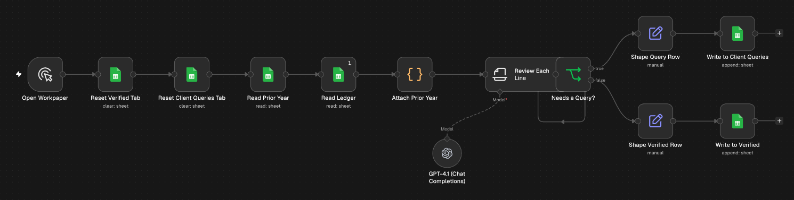

# AI workpaper reviewer for accountants

Reviews a small company's general ledger line by line at year end. Lines that check out go to a Verified tab. Lines that need an answer from the client go to a Client Queries tab with the question already written.

## Trigger

Manual. Run it from the editor when a client's ledger is ready to review.

## How it works

1. Clears the Verified and Client Queries tabs so each run starts empty.
2. Reads the Ledger and Prior Year tabs from the same Google Sheet and puts last year's balance next to each ledger line, matched on the account.
3. GPT-4.1 reviews one line at a time against Australian tax treatment. It queries payments or drawings to a director (Division 7A), GST coded on GST-free items such as bank interest, ASIC fees and residential rent, equipment expensed as repairs, and amounts that have moved a long way from the prior year. Entertainment gets a note about FBT.
4. Each line comes back as verified or query, with a confidence score, the issue type and the reason.
5. The result goes to the matching tab.

## Google Sheet tabs

| Tab | Columns |
|---|---|
| Ledger | Account, Description, Amount, GST Code |
| Prior Year | Account, Prior Year Balance |
| Verified | Account, Description, Amount, Confidence, Reason |
| Client Queries | Account, Description, Amount, Issue Type, Query, Confidence, Reason |

## Known limits

- It reviews one line at a time, so it won't spot a pattern that only shows up across several lines.
- The rules are Australian and written for a small Pty Ltd at a 30 June year end.
- It raises queries and doesn't post any adjustments to the ledger.
- Every run starts by clearing the Verified and Client Queries tabs, so copy anything you want to keep first.

## Credentials

- Google Sheets (OAuth2)
- OpenAI

## Import

Import `workflow.json` (Workflows, Import from File), connect both credentials and replace `YOUR_GOOGLE_SHEET_ID` on the six Google Sheets nodes with your spreadsheet's id.
