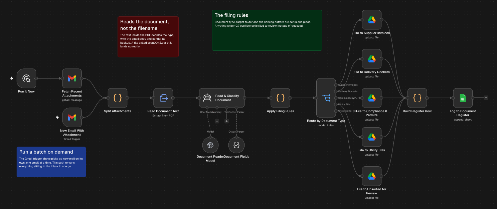

# Email attachment router

Watches a Gmail inbox for attachments, reads each document and saves it to the right Google Drive folder under a consistent file name. Every filing is logged to a register sheet. Anything the model isn't sure about goes to a review folder with the reason.

## Trigger

A Gmail trigger checks for new mail with attachments every hour. There's also a manual path, Run It Now, that picks up every attachment in the inbox in one batch.

## How it works

1. Each attachment is split out as its own item, along with the email it came in on.
2. The text is pulled out of the PDF and passed to an AI agent on GPT-5.4 mini together with the email. The agent gives the text inside the document the most weight and the file name the least, so a file called `scan0042.pdf` is still sorted by what's in it.
3. The agent returns the document type and a confidence score, plus the details it found such as the vendor and the amount.
4. The filing rules are in one code step. It picks the folder and renames the file in a fixed pattern, for example `2026-10-14_Harbour-Produce_Invoice_INV-2231.pdf`. A confidence under 0.7 or an unknown type sends the file to the review folder with `NEEDS-REVIEW` in its name.
5. The file is uploaded to its Drive folder.
6. Each filing adds a row to the Register tab with the old and new file names and a link to the file.

## Folders

| Folder | Gets |
|---|---|
| 01 Supplier Invoices | Bills from food, drink, linen and equipment suppliers |
| 02 Delivery Dockets | Packing slips and goods received notes |
| 03 Compliance & Permits | Inspections, permits, certificates and insurance |
| 04 Utility Bills | Electricity, gas, water, waste, internet and phone |
| 99 Unsorted for Review | Anything under the confidence threshold or of no known type, such as statements and marketing |

## Known limits

- There's no OCR. A scanned document is sorted on the email and the file name alone, which usually means a low confidence and the review folder.
- Each attachment is classified on its own, so a PDF holding several documents gets one type.

## Credentials

- Gmail (OAuth2)
- OpenAI
- Google Drive (OAuth2)
- Google Sheets (OAuth2)

## Import

Import `workflow.json`, connect the credentials, then set `YOUR_DRIVE_FOLDER_ID` on the five Drive nodes, `YOUR_GOOGLE_SHEET_ID` on Log to Document Register, and the `you@example.com` address in both Gmail search filters. Folder names and the confidence threshold are at the top of the Apply Filing Rules node.
