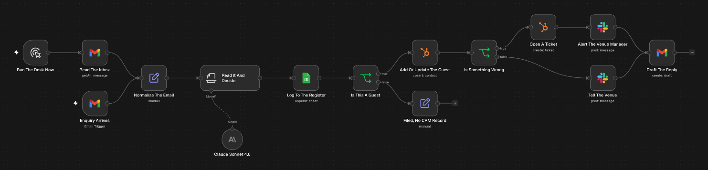

# Hospitality enquiry desk

Sorts the shared enquiries inbox for a restaurant group with three venues. Claude reads each email, works out which venue it's for and what kind of message it is, and every email is logged to a register with the reason. Guests get a HubSpot contact and a reply drafted in Gmail for someone to approve. A complaint also opens a HubSpot ticket and alerts the venue manager in Slack.

## Trigger

A Gmail trigger checks the inbox every hour. There's also a manual path, Run The Desk Now, that reads the inbox in one batch.

## How it works

1. Each email is reduced to sender, subject and body.
2. Claude Sonnet decides the venue, the category, whether the sender is a guest, the sentiment and a one line summary, and drafts a reply for guests. Supplier invoices, job applications and mailing list email are logged with no reply.
3. Every email is appended to the Register tab in Google Sheets with the decision and the reason.
4. A guest is added to HubSpot, or updated if they're already there.
5. If the message is negative, a HubSpot ticket is opened against the guest and the venue manager gets a Slack alert. Otherwise the venue gets a Slack note with what the guest wants.
6. The reply is saved as a Gmail draft in the guest's thread. Nothing is sent until someone approves it.

The drafting instructions stop the model inventing prices, dates, table availability or offers. When a reply needs something that isn't in the guest's email, it says a person will confirm.

## Known limits

- The Gmail trigger checks once an hour, so an email can wait up to an hour before it's sorted.
- The manual path reads the 6 most recent emails. Raise the limit on Read The Inbox for a bigger batch.
- The three venue names are written into the prompt.
- Replies stay as drafts until someone sends them.

## Credentials

- Gmail (OAuth2)
- Anthropic
- Google Sheets (OAuth2)
- HubSpot, an app token for the contact node and OAuth2 for the ticket node
- Slack (OAuth2)

## Import

Import `workflow.json`, connect the credentials, then replace `YOUR_GOOGLE_SHEET_ID` with your register sheet, `YOUR_SLACK_CHANNEL_ID` on both Slack nodes, and the `you@example.com` address in both Gmail search filters with the inbox you want watched. Change the three venue names in the Read It And Decide prompt to your own.
