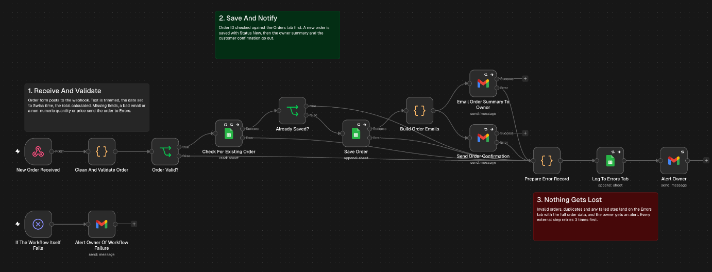
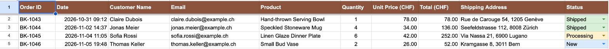

# Order processing

Takes orders from a web form or any JSON POST, checks them, rejects duplicates, saves good orders to Google Sheets and emails the owner and the customer. Every order that fails a check, and every step that fails, ends up on an Errors tab with the full order and an alert to the owner. There's no AI in this one.



## Trigger

A webhook that accepts a POST. It reads a Tally form submission or a plain JSON body like this:

```json
{
  "order_id": "bk-1042",
  "customer_name": "Anna Keller",
  "email": "anna@example.com",
  "product": "Speckled Mug",
  "quantity": 2,
  "price": 34,
  "shipping_address": "Rue du Rhone 12\n1204 Geneva"
}
```

## How it works

1. Clean And Validate tidies the order. It trims the text, uppercases the order ID, lowercases the email, joins the address lines and works out the total. It then checks for missing fields, an invalid email, a quantity that isn't a whole number above zero and a price that isn't a positive amount.
2. A valid order is looked up by order ID on the Orders tab. If it's already there, it's a duplicate.
3. A new order is saved to Orders with Status New.
4. The owner gets an order summary email and the customer gets a confirmation.
5. Invalid orders, duplicates and any Google Sheets or Gmail step that still fails after 3 retries go to Prepare Error Record. It writes the error type and the details to the Errors tab, says whether the order was saved, and emails the owner an alert.
6. An Error Trigger inside the workflow emails the owner if the workflow itself crashes. To use it, open Workflow settings and set this workflow as its own error workflow.



The Orders tab after four orders.

## Known limits

- One product per order. A cart with several lines needs the validation and the sheet columns extended.
- Duplicates are caught on the order ID only.
- Prices are in CHF and dates in Swiss time. Both are set in the code nodes.
- The workflow failure alert only works once the workflow is set as its own error workflow.

## Credentials

- Google Sheets (OAuth2)
- Gmail (OAuth2)

## Import

Import `workflow.json`, connect both credentials and replace `YOUR_GOOGLE_SHEET_ID` on the three sheet nodes. The owner's address is `you@example.com` on the three alert and summary emails and on the confirmation's reply-to, and the sheet link inside two of the code nodes is `YOUR_GOOGLE_SHEET_URL`. Your sheet needs an Orders tab and an Errors tab with the columns shown in Save Order and Log To Errors Tab. The webhook path is `new-order-received`.
