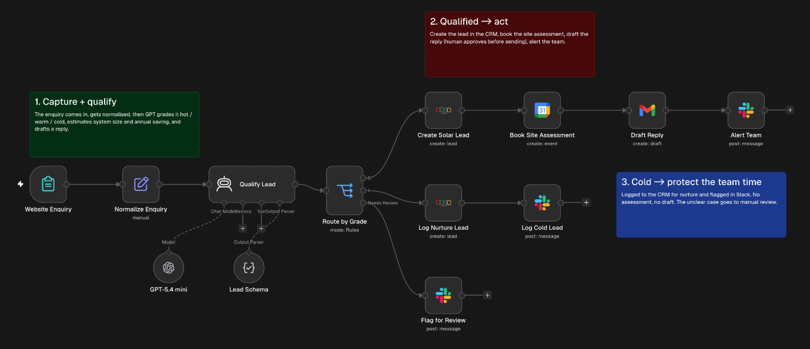

# Solar lead qualifier

Grades every website enquiry for a solar installer as hot, warm or cold, with an estimated system size and annual saving. Good leads go straight into Zoho CRM with a site assessment booked and a reply drafted. Cold leads are logged for nurture. Anything the model can't grade is flagged for a person.

## Trigger

An n8n Form Trigger. The enquiry form is part of the workflow and asks for name, email, phone, suburb, property type, quarterly power bill and a message.

## How it works

1. The form answers are tidied into one record.
2. An AI agent on GPT-5.4 mini grades the enquiry against written rules. A freestanding house or commercial premises with a quarterly bill of $600 or more and clear intent is hot. Lower usage, a townhouse or a vague message is warm. An apartment with no roof of its own is cold. The agent returns a fixed set of fields through a structured output parser, so the next steps always get the same fields.
3. Hot and warm leads are created in Zoho CRM with the grade, the estimates and the reasoning in the description. A 30 minute site assessment goes into Google Calendar, a reply is saved as a Gmail draft for approval, and the sales channel in Slack gets an alert.
4. Cold leads are created in Zoho as Not Qualified and noted in Slack. No booking and no draft.
5. If the grade comes back as anything else, the enquiry is posted to Slack for manual review.

The calendar step books 10am the next day. Change it to your real availability before using it.

## Known limits

- The system size and saving are the model's estimates from the bill band and property type, not a quote.
- There's no duplicate check, so the same person submitting twice becomes two Zoho leads.
- Every site assessment goes into the same 10am slot the next day.
- Replies stay as drafts until someone sends them.

## Credentials

- OpenAI
- Zoho CRM (OAuth2)
- Google Calendar (OAuth2)
- Gmail (OAuth2)
- Slack (OAuth2)

## Import

Import `workflow.json`, connect the credentials, then set `YOUR_CALENDAR_ID` on Book Site Assessment and `YOUR_SLACK_CHANNEL_ID` on the three Slack nodes. Publish the workflow to get the form's public URL.
