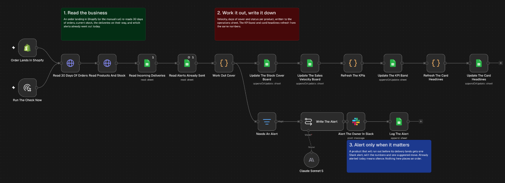
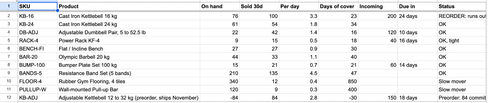

# Stock cover and reorder alerts

Works out how many days of stock each product has left from its Shopify sales, compares that with the deliveries already on order, and sends one Slack alert when a product will run out before its delivery arrives. The numbers are written to an operations sheet on every run. Nothing here places an order.

## Trigger

A new order in Shopify (`orders/create`). There's also a manual path, Run The Check Now.

## How it works

1. Reads the last 30 days of orders and every product's current stock from the Shopify Admin GraphQL API, two HTTP requests in total.
2. Reads the deliveries on order from the Incoming tab, and the alerts already sent today from the Alerts tab.
3. A code step works out each product's daily sales rate over 30 days and over 7 days, and how long its stock lasts at each rate. Each product then gets a status from OK up to REORDER, and a REORDER status says how many days before the delivery the product runs out.
4. The results are written to four tabs in the sheet. Rows are updated in place, so the sheet always shows the latest run.
5. Products that need an alert and haven't had one today go to Claude Sonnet, which writes a short alert with the numbers and one suggested action.
6. The alert is posted to Slack and logged on the Alerts tab, so that product stays quiet for the rest of the day.

The Stock Cover tab after a run.

## Known limits

- The Shopify reads take the first 250 orders and the first 100 products with no paging. A bigger store needs paging added to both HTTP requests.
- It only knows about deliveries that someone has entered on the Incoming tab.
- Each product gets at most one alert a day.
- It suggests an action and never places an order.

## Credentials

- Shopify access token (for the trigger)
- HTTP header auth with the header `X-Shopify-Access-Token`, for the two GraphQL reads
- Google Sheets (OAuth2)
- Anthropic
- Slack (OAuth2)

## Import

Import `workflow.json` and connect the credentials. Replace `your-store.myshopify.com` in both HTTP Request nodes with your store, then set `YOUR_GOOGLE_SHEET_ID` on the sheet nodes and `YOUR_SLACK_CHANNEL_ID` on the Slack node. Each Google Sheets node shows the tab it reads or writes, and your sheet needs all six.
